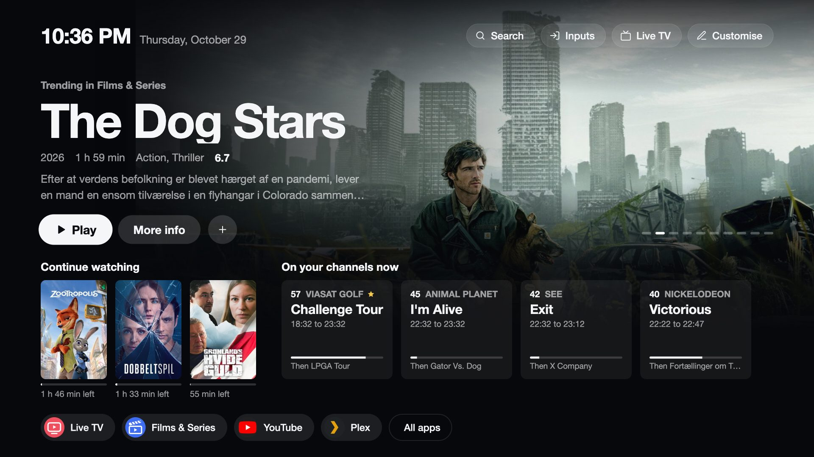

# The launcher

The launcher replaces LG's Home. It is a web page of the project that the TV's browser runs, so it starts fast and works the
same on every supported webOS version.

## The screen

In this fork Home opens on something to watch (it replaced the dock and app grid):

- **Top bar.** The clock and date, then **Search** (Films & Series' search), your top buttons (Inputs, Live TV, Settings or
  any app) and **Customise**.
- **A Trending title.** One film from [Films & Series](vod.md)' Trending row over its backdrop, with its year, length,
  genres, rating and description, and three buttons: **Play** (or **Resume** with the time left, when you started it),
  **More info** (its page in Films & Series) and **+** (My list). Every 15 seconds it slides to the next of the first ten
  Trending titles while nobody uses the remote, also with the focus resting on Play where Home puts it. Once you move to its
  buttons it stays, and it never slides within four seconds of a key, so OK always plays the title you see. The markers on
  the right show which one is shown.
- **Continue watching.** The titles you started, as in Films & Series (a series once, with its episode), newest first, with
  the time left. OK continues where you stopped.
- **On your channels now.** Your [Live TV](live-tv.md) favourites (marked with a star), then the channels you watched
  last, each with the programme on now, its times, how far it is and what follows (between two programmes: the next one and when
  it starts). OK tunes the channel.
- **The strip.** Live TV and Films & Series, then up to six apps or inputs you put on Home, the other inputs on Home, and
  **All apps** (every app that is not hidden, in the order chosen in Customise).

When Films & Series is not set up or its server cannot be reached, the top shows the channel you watched last with a
**Watch** button instead, and Continue watching is left out. With Live TV switched off there are no channel cards and
Continue watching uses the whole width. Home appears at once from what it showed last and fills in when the service answers.

## Keys

| Action | How |
|---|---|
| Play the Trending title, continue a title, tune a channel, open an app | OK |
| Back from a title opened on Home | Back (from the player to the title's page, then Home) |
| App options (move, remove from Home, hide) | Hold OK on an app in the strip or in All apps |
| Remove a top button | Hold OK on it |
| Customise | The **Customise** button |
| Switch input | The **Inputs** button |
| Put an input on Home | Hold OK on it in the Inputs list |
| Close running apps | Back on the home screen |

Up or Down into the Trending title always lands on Play. The Home key brings the focus back to Play. The Magic Remote pointer
works too: pointing and clicking, and holding the button on an app for its options.

## Running apps

Back on the home screen lists the apps that are open, as LG's Home does with its Recents on a second Back. OK closes an app,
**Close all** closes every app in the list, and Back leaves it. Closing an app also removes it from LG's recent apps.

It lists the apps the launcher knows, including the ones you hid from Home; Home itself, CleanYourTV's own apps and the TV's
system apps are never in it. The list is read when it opens and closes when you leave Home. Suggested and first built by
[Steefzar](https://github.com/lasharor/cleanyourtv-WebOS/issues/16).

## Customise

**Customise** holds:

- the **top buttons** (add Inputs, Settings, Live TV or any app, or remove one),
- **hidden apps** (show them again),
- the **app order** (most used first, or A to Z),
- the **clock** format (automatic, 12 or 24 hour),
- **Reset customisation**.

The strip holds up to six apps or inputs after Live TV and Films & Series. Hold OK on an app (in the strip or in **All apps**) and
choose **Add to Home**, **Move left**, **Move right**, **Remove from Home** or **Hide app**.

## Inputs

The **Inputs** button lists HDMI inputs by the names LG shows, with what is connected and a marker on the active one. OK
switches to the input.

### An input on Home

Hold OK on an input in the Inputs list and choose **Add to Home**. The input then shows in the strip with the HDMI symbol, the
name the TV gives it (for example the name of the connected console) and a dot when something is connected; with nothing
connected it is dimmed and still switches to it. OK switches to the input; holding OK on it offers **Remove from Home**, which is
also in the Inputs list.

In the [Inputs picker](input-key.md) of the Input key, holding OK on an HDMI input does the same: it is added to Home, or taken off
when it already is. An input in the dock also shows in the picker's row of dock apps.

Suggested and first built by [ibexes](https://github.com/lasharor/cleanyourtv-WebOS/pull/25).

## Icons

The strip uses each app's own icon; Live TV and Films & Series have their own.

## Language

Menus follow the TV's language: English, Dutch, German, French and Spanish. Home's new texts and Films & Series are in English.

## Themes

The colours, font, animation speed and wallpaper of the home screen come from the [theme](themes.md) chosen in the manager app.
In this fork Home's layout is fixed, so a theme's layout settings (dock, grid, shelf, clock and button positions, tile sizes)
do not change it; the wallpaper shows where there is no backdrop.

## Settings file

Settings are stored on the TV in `/media/developer/cleanyourtv/config.json`:

| Key | Meaning |
|---|---|
| `dock` | App and input ids in Home's strip after Live TV and Films & Series (up to six). |
| `topbar` | The buttons at the top. |
| `hidden` | App ids you hid. |
| `pinnedInputs` | The inputs on Home: `{id, label, port}`, `id` being the input's app (for example `com.webos.app.hdmi2`). |
| `sort` | `usage` or `alpha`. |
| `clock` | `auto`, `12` or `24`. |

See [`config.example.json`](https://github.com/lasharor/cleanyourtv-WebOS/blob/main/config.example.json). Change settings in
the launcher; the file is read and written by the service.
